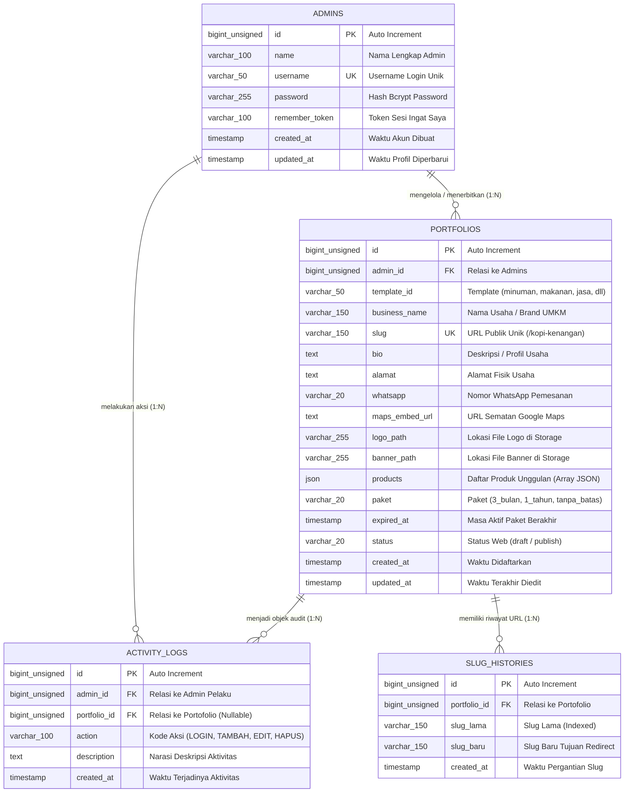

# DOKUMEN ERD & MAPPING TABEL DATABASE
## PLATFORM CMS WEB BUILDER - PORTOFOLIO UMKM
**Penyusun:** Hanan Aria Santagama  
**Kelas / Jurusan:** XII RPL 1 — Rekayasa Perangkat Lunak  
**Sekolah:** SMKN 1 Majalengka  
**Sistem Basis Data:** MySQL (InnoDb Engine) / Eloquent ORM Laravel 13

---

## 1. Apa itu ERD & Mapping Tabel? (Penjelasan Singkat untuk Penguji)

* **ERD (Entity Relationship Diagram)** adalah diagram visual yang menggambarkan rancangan database: tabel-tabel apa saja yang ada (*Entitas*), data apa saja yang disimpan di dalamnya (*Atribut*), serta bagaimana tabel-tabel tersebut saling terhubung satu sama lain (*Relasi*).
* **Mapping Tabel (Kamus Data / Relational Mapping)** adalah tabel rincian teknis yang menjelaskan nama kolom, tipe data, panjang karakter, batasan (*constraint* seperti Primary Key/Foreign Key/Unique), dan keterangannya secara terstruktur.

---

## 2. Diagram ERD (Entity Relationship Diagram)

Berikut adalah diagram hubungan relasi antar entitas dalam sistem CMS Web Builder:

---

## 3. Mapping Tabel & Kamus Data (Data Dictionary)

### A. Tabel `admins`
Tabel master untuk menyimpan akun pengelola sistem platform CMS Web Builder.

| No | Nama Kolom | Tipe Data | Nullable | Kunci | Nilai Default | Keterangan & Fungsi |
| :--- | :--- | :--- | :---: | :---: | :--- | :--- |
| 1 | `id` | BIGINT UNSIGNED | Tidak | **PK** | AUTO_INCREMENT | Identifier unik akun admin |
| 2 | `name` | VARCHAR(100) | Tidak | - | - | Nama lengkap admin pengelola |
| 3 | `username` | VARCHAR(50) | Tidak | **UK** | - | Username untuk login (unik, tidak boleh kembar) |
| 4 | `password` | VARCHAR(255) | Tidak | - | - | Kata sandi login terenkripsi algoritma Bcrypt |
| 5 | `remember_token` | VARCHAR(100) | Ya | - | NULL | Token sesi pengaman fitur "Remember Me" Laravel |
| 6 | `created_at` | TIMESTAMP | Ya | - | NULL | Waktu akun admin dibuat |
| 7 | `updated_at` | TIMESTAMP | Ya | - | NULL | Waktu profil admin terakhir diperbarui |

---

### B. Tabel `portfolios`
Tabel operasional utama untuk menyimpan seluruh data website portofolio klien UMKM.

| No | Nama Kolom | Tipe Data | Nullable | Kunci | Nilai Default | Keterangan & Fungsi |
| :--- | :--- | :--- | :---: | :---: | :--- | :--- |
| 1 | `id` | BIGINT UNSIGNED | Tidak | **PK** | AUTO_INCREMENT | Identifier unik portofolio UMKM |
| 2 | `admin_id` | BIGINT UNSIGNED | Tidak | **FK** | - | Relasi ke `admins.id` (Admin yang mendaftarkan) |
| 3 | `template_id` | VARCHAR(50) | Tidak | - | `'minuman'` | Pilihan konsep visual (`minuman`, `makanan`, `jasa`, `organisasi`, `tokoh`) |
| 4 | `business_name`| VARCHAR(150) | Tidak | - | - | Nama usaha atau brand resmi UMKM |
| 5 | `slug` | VARCHAR(150) | Tidak | **UK** | - | Alamat URL unik publik (misal: `/kopi-kenangan`) |
| 6 | `bio` | TEXT | Ya | - | NULL | Profil singkat, cerita usaha, atau keunggulan produk |
| 7 | `alamat` | TEXT | Ya | - | NULL | Alamat fisik kedai/toko untuk rute Google Maps |
| 8 | `whatsapp` | VARCHAR(20) | Ya | - | NULL | Nomor kontak WA untuk tombol direct order |
| 9 | `maps_embed_url`| TEXT | Ya | - | NULL | URL sematan Google Maps iframe (disanitasi otomatis) |
| 10 | `logo_path` | VARCHAR(255) | Ya | - | NULL | Path letak file logo di `storage/app/public/uploads` |
| 11 | `banner_path` | VARCHAR(255) | Ya | - | NULL | Path letak file banner di `storage/app/public/uploads` |
| 12 | `products` | JSON | Ya | - | NULL | Array JSON fleksibel (Nama produk, harga, foto, deskripsi) |
| 13 | `paket` | VARCHAR(20) | Ya | - | NULL | Jenis paket: `'3_bulan'`, `'1_tahun'`, atau `'tanpa_batas'` |
| 14 | `expired_at` | TIMESTAMP | Ya | - | NULL | Tanggal berakhir masa aktif paket berlangganan |
| 15 | `status` | VARCHAR(20) | Tidak | - | `'draft'` | Status akses web: `'draft'` (tertutup) atau `'publish'` (publik) |
| 16 | `created_at` | TIMESTAMP | Ya | - | NULL | Waktu pendaftaran pertama kali |
| 17 | `updated_at` | TIMESTAMP | Ya | - | NULL | Waktu terakhir perubahan data UMKM |

---

### C. Tabel `activity_logs`
Tabel audit trail (rekam jejak sistem) untuk menjamin akuntabilitas seluruh aksi admin.

| No | Nama Kolom | Tipe Data | Nullable | Kunci | Nilai Default | Keterangan & Fungsi |
| :--- | :--- | :--- | :---: | :---: | :--- | :--- |
| 1 | `id` | BIGINT UNSIGNED | Tidak | **PK** | AUTO_INCREMENT | Identifier unik log aktivitas |
| 2 | `admin_id` | BIGINT UNSIGNED | Tidak | **FK** | - | Relasi ke `admins.id` (Admin yang melakukan aksi) |
| 3 | `portfolio_id`| BIGINT UNSIGNED | Ya | **FK** | NULL | Relasi ke `portfolios.id` (Opsional jika aksi spesifik ke toko) |
| 4 | `action` | VARCHAR(100) | Tidak | - | - | Kode aksi singkat (`LOGIN`, `LOGOUT`, `TAMBAH_PORTFOLIO`, `EDIT_PORTFOLIO`, `HAPUS_PORTFOLIO`) |
| 5 | `description` | TEXT | Tidak | - | - | Penjelasan naratif aksi yang dicatat |
| 6 | `created_at` | TIMESTAMP | Tidak | - | CURRENT_TIMESTAMP | Waktu persis aktivitas terjadi |

---

### D. Tabel `slug_histories`
Tabel pendukung SEO (Search Engine Optimization) untuk mencegah broken link (HTTP 404) saat UMKM mengganti nama URL usahanya.

| No | Nama Kolom | Tipe Data | Nullable | Kunci | Nilai Default | Keterangan & Fungsi |
| :--- | :--- | :--- | :---: | :---: | :--- | :--- |
| 1 | `id` | BIGINT UNSIGNED | Tidak | **PK** | AUTO_INCREMENT | Identifier unik riwayat slug |
| 2 | `portfolio_id`| BIGINT UNSIGNED | Tidak | **FK** | - | Relasi ke `portfolios.id` |
| 3 | `slug_lama` | VARCHAR(150) | Tidak | **INDEX**| - | Slug lama sebelum diedit (diberi indeks pencarian cepat) |
| 4 | `slug_baru` | VARCHAR(150) | Tidak | - | - | Slug baru tujuan redirect otomatis (HTTP 301) |
| 5 | `created_at` | TIMESTAMP | Tidak | - | CURRENT_TIMESTAMP | Waktu terjadinya pergantian slug |

---

## 4. Aturan Relasi Database & Referential Integrity

1. **`admins` ➔ `portfolios` (One-to-Many / 1 : N)**:
   - Satu Admin dapat mengelola banyak portofolio UMKM.
   - Menggunakan aturan `ON DELETE CASCADE`: Jika akun admin dihapus, portofolio yang dikelola ikut dibersihkan atau ditangani.
2. **`admins` ➔ `activity_logs` (One-to-Many / 1 : N)**:
   - Satu Admin memiliki banyak rekam jejak aktivitas audit sistem.
   - Menggunakan aturan `ON DELETE CASCADE`.
3. **`portfolios` ➔ `activity_logs` (One-to-Many / 1 : N)**:
   - Satu portofolio dapat memiliki banyak catatan log aktivitas perubahan.
   - Menggunakan aturan `ON DELETE SET NULL`: Jika toko UMKM dihapus, log aktivitas tetap tersimpan sebagai catatan historis (kolom `portfolio_id` berubah menjadi `NULL`).
4. **`portfolios` ➔ `slug_histories` (One-to-Many / 1 : N)**:
   - Satu portofolio dapat memiliki beberapa riwayat pergantian slug.
   - Menggunakan aturan `ON DELETE CASCADE`: Jika toko dihapus permanen, riwayat redirect slug-nya otomatis dibersihkan.

---

## 5. Cara Menjawab Penguji saat Menjelaskan Database

Jika penguji meminta: *"Coba jelaskan relasi database yang kamu rancang di aplikasi ini!"*, kamu bisa menjawab dengan lancar seperti ini:

> *"Database aplikasi ini terdiri dari 4 tabel utama:  
> 1. Tabel **admins** sebagai master data akun pengelola.  
> 2. Tabel **portfolios** sebagai tabel utama penyimpan profil UMKM, pilihan template, link slug unik, nomor WhatsApp, dan kolom JSON fleksibel untuk menampung banyak produk.  
> 3. Tabel **activity_logs** yang berelasi ke admin dan portfolio untuk mencatat jejak audit (kapan admin menambah, mengedit, atau menghapus web).  
> 4. Tabel **slug_histories** yang menyimpan riwayat URL toko lama agar saat slug diedit, pelanggan yang membuka link lama otomatis dialihkan dengan redirect HTTP 301 tanpa error 404.  
> Seluruh relasi dilengkapi Foreign Key constraint dengan aturan cascade dan set-null untuk menjamin integritas data di MySQL."*
