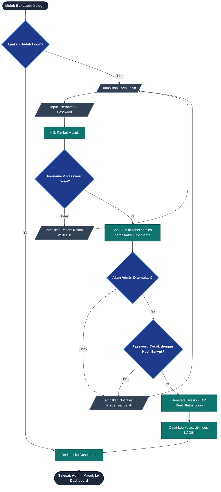
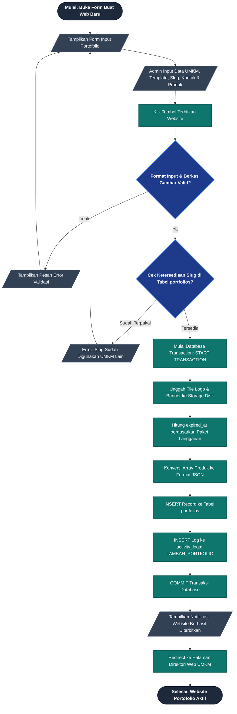

# DIAGRAM ALUR (FLOWCHART) SISTEM
## Platform CMS Web Builder — Web Portofolio UMKM
* **Penyusun:** Hanan Aria Santagama (Kelas XII RPL 1 — SMKN 1 Majalengka)
* **Paket Keahlian:** Rekayasa Perangkat Lunak (RPL)
* **Format:** Standar Diagram Alur Sistem (Flowchart Mermaid — Kompatibel Penuh dengan Obsidian & Markdown Preview)
* **Jumlah Flowchart:** **3 Diagram Alur Lengkap** (Sesuai Poin 3 Soal Ujikom)

---

> [!IMPORTANT]
> **Kesesuaian dengan Soal Ujian Praktik Kejuruan (Poin 3):**
> Dokumen ini memuat **Deskripsi Proses** dan **Diagram Alur (Flowchart)** untuk 3 proses utama sistem:
> 1. **Flowchart 1:** Proses Login Admin ke Dashboard
> 2. **Flowchart 2:** Proses Input Data, Validasi Ketersediaan Slug/URL, dan Penerbitan (*Publish*) Portofolio UMKM
> 3. **Flowchart 3:** Proses Akses Publik Halaman Portofolio Berdasarkan Slug/URL (termasuk Penanganan Slug Tidak Ditemukan / Error 404 & SEO 301 Redirect)

---

## A. PROSES LOGIN ADMIN KE DASHBOARD (Poin 3.a Soal Ujikom)

### 1. Deskripsi Alur Proses
1. **Mulai:** Pengguna membuka peramban (*browser*) dan mengakses alamat URL `/admin/login`.
2. **Pengecekan Sesi Aktif:** Sistem memeriksa apakah admin sudah dalam status login.
   * Jika **Ya** (sudah login), sistem langsung mengalihkan (*redirect*) ke `/admin/dashboard`.
   * Jika **Tidak**, sistem menampilkan formulir login.
3. **Input Data:** Pengguna memasukkan data `username` dan `password`, lalu menekan tombol **Masuk**.
4. **Validasi Input Kolom:** Sistem memeriksa apakah kolom username dan password terisi.
   * Jika **Kosong**, sistem menampilkan pesan error: *"Username dan password wajib diisi"* dan kembali ke formulir.
5. **Pencarian Akun:** Sistem mencari data pengguna di tabel `admins` berdasarkan username yang dimasukkan.
   * Jika akun **Tidak Ditemukan**, sistem menampilkan notifikasi: *"Username atau kata sandi salah"* dan kembali ke formulir.
6. **Verifikasi Kata Sandi (Bcrypt):** Jika akun ditemukan, sistem mencocokkan kata sandi teks biasa dengan hash terenkripsi di database menggunakan fungsi `Hash::check()`.
   * Jika **Tidak Cocok**, sistem menampilkan notifikasi kesalahan kredensial dan kembali ke formulir.
7. **Pembuatan Sesi & Audit Trail:** Jika kata sandi **Cocok**:
   * Sistem membuat sesi login aman (*regenerate session ID* untuk mencegah *session fixation*).
   * Sistem otomatis mencatat aksi ke tabel `activity_logs` dengan aksi `LOGIN`.
8. **Redirect Dashboard:** Sistem mengalihkan admin ke halaman utama `/admin/dashboard`.
9. **Selesai:** Admin berhasil masuk ke panel kendali.

---

### 2. Pseudocode (Kode Semu Algoritma Login)
```pascal
ALGORITMA LoginAdmin
DEKLARASI:
    username, password : STRING
    admin              : RECORD
    isMatch            : BOOLEAN

DESKRIPSI:
    MULAI
        Buka halaman "/admin/login"
        
        JIKA sesi_admin_aktif = TRUE MAKA
            REDIRECT("/admin/dashboard")
            SELESAI
        AKHIR JIKA

        TAMPILKAN form_login
        INPUT username, password
        KLIK tombol_masuk

        // 1. Validasi Keberadaan Input
        JIKA username = "" ATAU password = "" MAKA
            TAMPILKAN notifikasi "Username dan password wajib diisi!"
            KEMBALI KE form_login
        AKHIR JIKA

        // 2. Query Akun ke Database
        admin <- QUERY "SELECT * FROM admins WHERE username = :username LIMIT 1"

        JIKA admin TIDAK DITEMUKAN MAKA
            TAMPILKAN notifikasi "Kredensial akun tidak cocok!"
            KEMBALI KE form_login
        AKHIR JIKA

        // 3. Verifikasi Hash Password Bcrypt
        isMatch <- CEK_HASH_BCRYPT(password, admin.password)

        JIKA isMatch = TRUE MAKA
            BUAT_SESI_LOGIN(admin.id)
            SIMPAN_LOG_AKTIVITAS("LOGIN", "Admin berhasil masuk ke dashboard")
            REDIRECT("/admin/dashboard")
            TAMPILKAN "Selamat datang di Panel Admin CMS Web Builder!"
        LAINNYA
            TAMPILKAN notifikasi "Password salah!"
            KEMBALI KE form_login
        AKHIR JIKA
    SELESAI
```

---

### 3. Diagram Alur (Flowchart Login)

*File Gambar Tersedia: [Dokumen/Flowchart_Login_Admin.png](file:///c:/laragon/www/CMSWebBuilder_Hanan/Dokumen/Flowchart_Login_Admin.png) dan [Dokumen/Flowchart_Login_Admin.svg](file:///c:/laragon/www/CMSWebBuilder_Hanan/Dokumen/Flowchart_Login_Admin.svg)*



---

## B. PROSES INPUT DATA & PENERBITAN PORTOFOLIO UMKM (Poin 3.b Soal Ujikom)

### 1. Deskripsi Alur Proses
1. **Mulai:** Admin memilih menu **Buat Web Baru** di dashboard (`/admin/portfolios/create`).
2. **Tampilkan Form:** Sistem menampilkan formulir penginputan portofolio UMKM.
3. **Input Data Portofolio:** Admin mengisikan data lengkap UMKM:
   * Nama UMKM, Pilihan Template (`barang`, `minuman`, `makanan`, `jasa`, `tokoh`), Alamat Slug URL (misal: `kopi-senja`).
   * Deskripsi Usaha (Bio), Alamat Fisik Kedai, Kontak WhatsApp, Akun Instagram, URL Google Maps Embed.
   * Unggah berkas Logo dan Banner toko.
   * Input daftar produk unggulan (Nama, Harga, Foto, Deskripsi).
   * Pilihan Paket Langganan (`3_bulan`, `1_tahun`, `tanpa_batas`) dan Status (`publish` / `draft`).
4. **Kirim Data:** Admin menekan tombol **Terbitkan Website**.
5. **Validasi Format Input:** Sistem memvalidasi kelayakan data di server (*Form Request*):
   * Format slug: huruf kecil, angka, dan strip (regex).
   * Format file logo & banner: ekstensi gambar (JPG, PNG, WEBP) dengan ukuran maksimal 2 MB.
   * Jika **Format Salah**, sistem mengembalikan pesan error validasi ke formulir.
6. **Validasi Ketersediaan Slug (Uniqueness):** Sistem memeriksa tabel `portfolios` apakah slug yang diminta sudah pernah didaftarkan oleh toko lain.
   * Jika **Sudah Terpakai**, sistem menolak penyimpanan dan menampilkan error: *"Slug URL sudah digunakan oleh UMKM lain. Silakan gunakan kombinasi lain."*
7. **Eksekusi Penyimpanan (Database Transaction):** Jika validasi lolos:
   * Sistem membuka transaksi database (`START TRANSACTION`).
   * Berkas logo dan banner diunggah ke storage disk publik (`storage/app/public/uploads`).
   * Sistem menghitung tanggal berakhir paket (`expired_at`).
   * Data disimpan ke tabel `portfolios` dengan status `publish` atau `draft`.
   * Sistem mencatat log audit ke tabel `activity_logs` (`action = 'TAMBAH_PORTOFOLIO'`).
   * Sistem melakukan `COMMIT` transaksi database.
8. **Tampilkan Sukses & Redirect:** Sistem menampilkan notifikasi sukses dan mengalihkan halaman ke Direktori Portofolio (`/admin/portfolios`).
9. **Selesai:** Website portofolio UMKM resmi terbit dan aktif.

---

### 2. Pseudocode (Kode Semu Input Data & Penerbitan)
```pascal
ALGORITMA TerbitkanPortofolioUMKM
DEKLARASI:
    nama_umkm, slug, template_id, bio, alamat, whatsapp, paket, status : STRING
    logo_file, banner_file                                             : FILE
    products_array                                                     : ARRAY
    isSlugUsed                                                         : BOOLEAN

DESKRIPSI:
    MULAI
        TAMPILKAN form_tambah_portofolio
        INPUT nama_umkm, slug, template_id, bio, alamat, whatsapp, logo_file, banner_file, products_array, paket, status
        KLIK tombol_terbitkan

        // 1. Validasi Format & Aturan Input Server
        JIKA nama_umkm = "" ATAU slug = "" ATAU template_id = "" MAKA
            TAMPILKAN notifikasi "Nama UMKM, Slug, dan Template wajib diisi!"
            KEMBALI KE form_tambah_portofolio
        AKHIR JIKA

        // 2. Validasi Ketersediaan Slug (Memanggil Function SQL CekKetersediaanSlug)
        isSlugUsed <- CEK_SLUG_DATABASE(slug)
        JIKA isSlugUsed = TRUE MAKA
            TAMPILKAN notifikasi "Error: Slug URL sudah dipakai UMKM lain!"
            KEMBALI KE form_tambah_portofolio
        AKHIR JIKA

        // 3. Database Transaction & File Upload
        START_TRANSACTION()
        COBA
            logo_path <- SIMPAN_FILE(logo_file, "public/uploads")
            banner_path <- SIMPAN_FILE(banner_file, "public/uploads")
            products_json <- JSON_ENCODE(products_array)
            expired_at <- HITUNG_KADALUARSA(paket)

            INSERT INTO portfolios (admin_id, nama_umkm, slug, template_id, bio, alamat, whatsapp, logo_path, banner_path, products, paket, expired_at, status)
            VALUES (SESSION.admin_id, nama_umkm, slug, template_id, bio, alamat, whatsapp, logo_path, banner_path, products_json, paket, expired_at, status)

            portfolio_id <- LAST_INSERT_ID()
            INSERT INTO activity_logs (admin_id, portfolio_id, action, description, created_at)
            VALUES (SESSION.admin_id, portfolio_id, "TAMBAH_PORTOFOLIO", CONCAT("Menerbitkan website: ", nama_umkm), NOW())

            COMMIT_TRANSACTION()
            REDIRECT("/admin/portfolios")
            TAMPILKAN notifikasi "Website portofolio berhasil diterbitkan!"
        TANGKAP_ERROR
            ROLLBACK_TRANSACTION()
            TAMPILKAN notifikasi "Terjadi kesalahan sistem saat menyimpan data!"
        AKHIR COBA
    SELESAI
```

---

### 3. Diagram Alur (Flowchart 2)


---

## C. PROSES AKSES PUBLIK & REDIRECT 301 / ERROR 404 (Poin 3.c Soal Ujikom)

### 1. Deskripsi Alur Proses
1. **Mulai:** Calon pelanggan atau pengunjung membuka peramban dan mengetik URL website UMKM: `domain.com/{slug}` (misalnya: `/kopi-senja`).
2. **Pencarian Slug Utama:** Sistem menjalankan query database ke tabel utama `portfolios` berdasarkan kolom `slug`.
3. **Kondisi 1: Slug Ditemukan di Tabel `portfolios`:**
   * Sistem memeriksa kolom `status` toko:
     * Jika status **`publish`**: Sistem mengambil data UMKM, mendeteksi `template_id` yang dipilih (`barang`, `minuman`, `makanan`, `jasa`, atau `tokoh`), lalu me-render tampilan website lengkap dengan katalog dan tombol order WhatsApp/Instagram (Status HTTP 200 OK).
     * Jika status **`draft`**: Sistem menampilkan halaman informasi bahwa website UMKM masih dalam tahap perancangan/draft oleh admin.
4. **Kondisi 2: Slug Tidak Ditemukan di Tabel `portfolios`:**
   * Sistem **tidak langsung memunculkan error 404**, melainkan memeriksa tabel `slug_histories` pada kolom `slug_lama` (fitur pelindung SEO dari tautan rusak jika admin pernah mengganti nama URL toko).
   * Jika slug lama **Ditemukan di `slug_histories`**:
     * Sistem mengambil `slug_baru` tujuan pengalihan.
     * Sistem melakukan **HTTP 301 Permanent Redirect** ke alamat baru (`/{slug_baru}`). Pengunjung otomatis dialihkan ke alamat baru tanpa error!
5. **Kondisi 3: Slug Tidak Ditemukan di Mana Pun:**
   * Jika di tabel `portfolios` tidak ada dan di riwayat `slug_histories` juga tidak ada:
   * Sistem mengeksekusi instruksi `abort(404)`.
   * Sistem menampilkan halaman kustom **Error 404 — Halaman Website Tidak Ditemukan**, lengkap dengan tombol kembali ke beranda.
6. **Selesai:** Respon halaman selesai dikirimkan ke peramban pengunjung.

---

### 2. Pseudocode (Kode Semu Akses Publik & SEO Redirect)
```pascal
ALGORITMA AksesPublikWebsite
DEKLARASI:
    slug_request : STRING
    portfolio    : RECORD
    history      : RECORD

DESKRIPSI:
    MULAI
        Buka URL "/{slug_request}"

        // 1. Cek di Tabel Utama Portfolios
        portfolio <- QUERY "SELECT * FROM portfolios WHERE slug = :slug_request LIMIT 1"

        JIKA portfolio DITEMUKAN MAKA
            JIKA portfolio.status = "publish" MAKA
                template <- portfolio.template_id
                RENDER_VIEW("public.templates." + template, portfolio)
                HTTP_RESPONSE(200, "OK")
                SELESAI
            LAINNYA
                TAMPILKAN "Website ini masih berstatus draft oleh pemilik usaha."
                SELESAI
            AKHIR JIKA
        AKHIR JIKA

        // 2. Jika Tidak Ada di Portfolios, Cek Riwayat SEO 301 (slug_histories)
        history <- QUERY "SELECT * FROM slug_histories WHERE slug_lama = :slug_request LIMIT 1"

        JIKA history DITEMUKAN MAKA
            REDIRECT_PERMANENT_301("/" + history.slug_baru)
            SELESAI
        AKHIR JIKA

        // 3. Jika Benar-Benar Tidak Ada di Mana Pun
        TAMPILKAN_HALAMAN_ERROR_404()
        HTTP_RESPONSE(404, "Not Found")
    SELESAI
```

---

### 3. Diagram Alur (Flowchart 3)
```mermaid
flowchart TD
    Start([Mulai: Pengunjung Buka URL /{slug}]) --> QueryPortfolio[Query SELECT ke Tabel portfolios WHERE slug = :slug]
    
    QueryPortfolio --> FoundPortfolio{Slug Ditemukan di portfolios?}
    
    %% CABANG 1: SLUG DITEMUKAN DI PORTFOLIOS
    FoundPortfolio -- Ya --> CheckStatus{Status Toko?}
    CheckStatus -- publish --> CheckTemplate[Pilih View Blade berdasarkan template_id]
    CheckTemplate --> RenderView[/Render Tampilan Web Portofolio UMKM (HTTP 200)/]
    RenderView --> EndSuccess([Selesai: Pengunjung Melihat Web UMKM])
    
    CheckStatus -- draft --> ShowDraft[/Tampilkan Notifikasi: Website Masih Berstatus Draft/]
    ShowDraft --> EndDraft([Selesai: Akses Tertutup])
    
    %% CABANG 2: CEK RIWAYAT SLUG LAMA (SEO)
    FoundPortfolio -- Tidak --> QueryHistory[Query SELECT ke Tabel slug_histories WHERE slug_lama = :slug]
    QueryHistory --> FoundHistory{Tercatat di slug_histories?}
    
    %% PENGALIHAN 301 REDIRECT
    FoundHistory -- Ya --> GetNewSlug[Ambil slug_baru Tujuan]
    GetNewSlug --> Redirect301[/Lakukan HTTP 301 Permanent Redirect ke /{slug_baru}/]
    Redirect301 --> QueryPortfolio
    
    %% CABANG 3: ERROR 404 NOT FOUND
    FoundHistory -- Tidak --> Abort404[Eksekusi Handler abort: 404]
    Abort404 --> Show404[/Tampilkan Halaman Kustom Error 404 Not Found/]
    Show404 --> End404([Selesai: Halaman Tidak Ditemukan])

    %% Styling Tema Obsidian
    classDef startEnd fill:#1e293b,stroke:#0f172a,stroke-width:2px,color:#ffffff,font-weight:bold;
    classDef process fill:#0f766e,stroke:#115e59,stroke-width:2px,color:#ffffff;
    classDef decision fill:#1e3a8a,stroke:#3b82f6,stroke-width:2px,color:#ffffff,font-weight:bold;
    classDef inOut fill:#334155,stroke:#475569,stroke-width:1.5px,color:#ffffff;

    class Start,EndSuccess,EndDraft,End404 startEnd;
    class QueryPortfolio,CheckTemplate,QueryHistory,GetNewSlug,Abort404 process;
    class FoundPortfolio,CheckStatus,FoundHistory decision;
    class RenderView,ShowDraft,Redirect301,Show404 inOut;
```

---

## 4. Tabel Rangkuman Simbol Standar Flowchart ANSI / ISO

Jika dewan penguji meminta kamu menggambar ulang bagan flowchart di papan tulis atau kertas buram ujian, gunakan simbol standar berikut:

| Bentuk Simbol | Nama Simbol | Arti & Fungsi dalam Diagram Alur |
| :---: | :--- | :--- |
| **Kapsul / Oval** | *Terminator* | Titik awal (*Start / Mulai*) dan titik akhir (*End / Selesai*) suatu alur sistem. |
| **Persegi Panjang** | *Process* | Menyatakan proses pengolahan data internal, query database, upload berkas, atau kalkulasi logika. |
| **Belah Ketupat** | *Decision* | Titik pengambilan keputusan/kondisi logika dengan 2 arah percabangan (*Ya/Tidak*, *True/False*). |
| **Jajar Genjang** | *Input / Output* | Menerima masukan dari pengguna (form input) atau menampilkan data/halaman web ke layar. |
| **Garis Panah** | *Flowline* | Menghubungkan antar-simbol dan menunjukkan arah jalannya alur instruksi program. |
