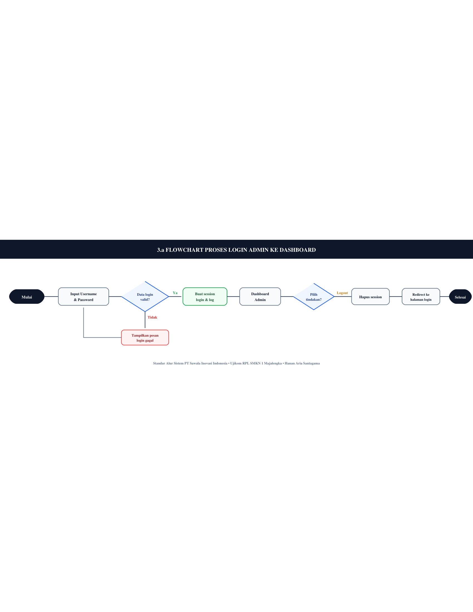
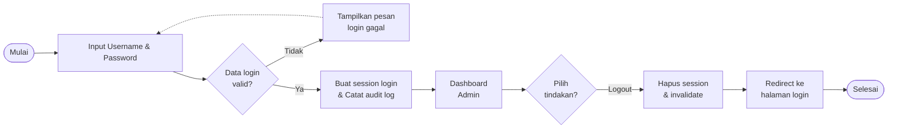
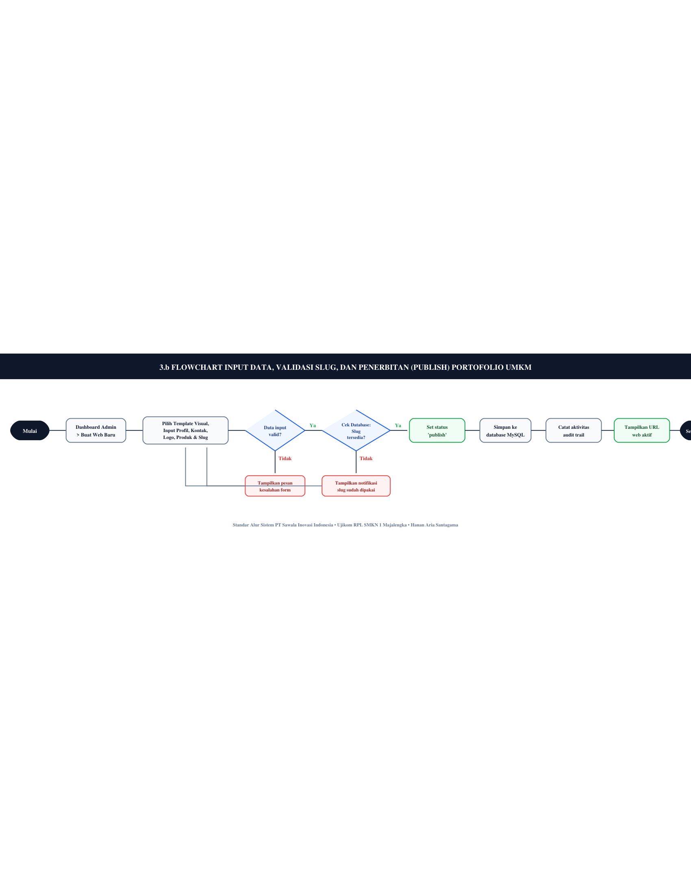
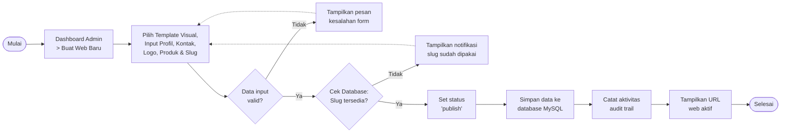
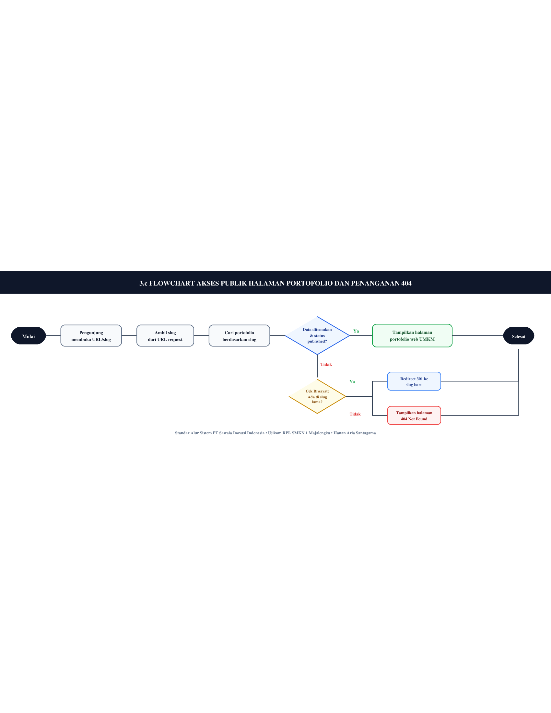
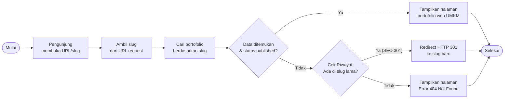

# DIAGRAM ALUR (FLOWCHART) RESMI UJIKOM
## Platform Web Portofolio UMKM — CMS Web Builder
**Penyusun:** Hanan Aria Santagama (Kelas XII RPL 1 — SMKN 1 Majalengka)  
**Standar Pengujian:** Soal Uji Kompetensi Keahlian (Nomor 3) & Panduan Teknis PT Sawala Inovasi Indonesia

---

## 3.a. Proses Login Admin ke Dashboard

---

## 3.b. Proses Input Data, Validasi Ketersediaan Slug/URL, dan Penerbitan (Publish) Halaman Portofolio UMKM

---

## 3.c. Proses Akses Publik Halaman Portofolio Berdasarkan Slug/URL & Penanganan Error 404

